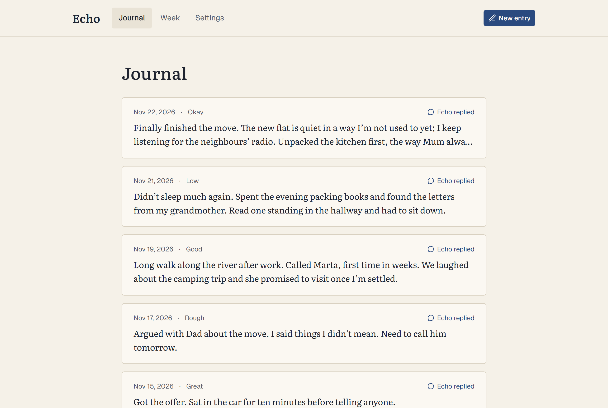
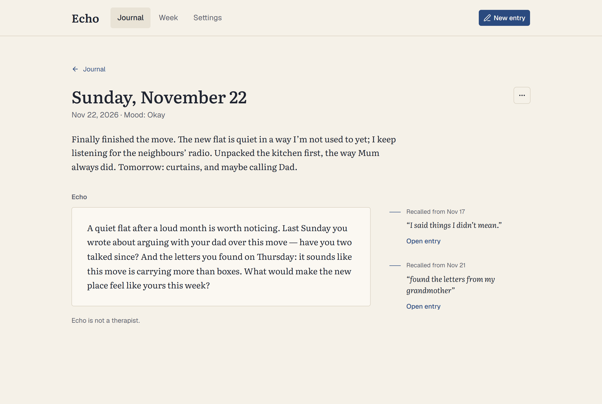
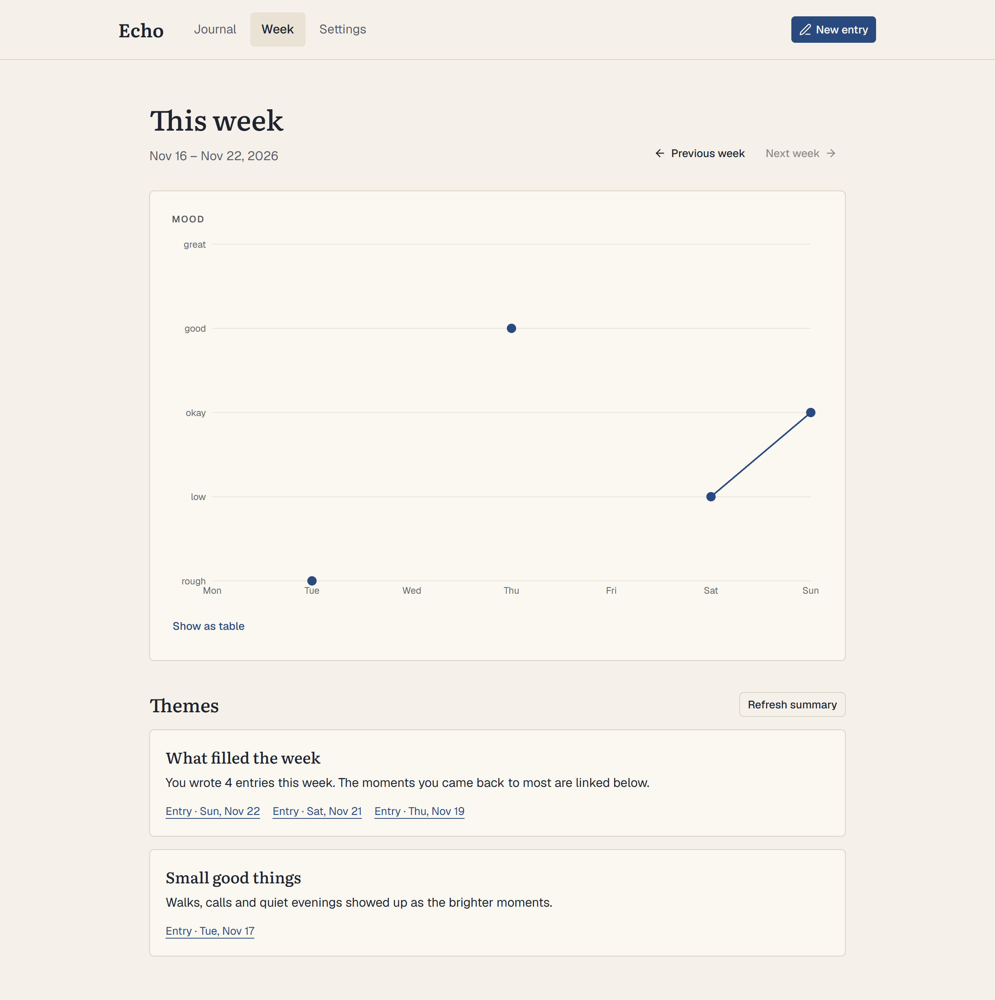
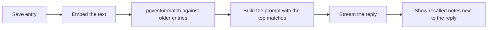

# Echo Journal

Echo is a web journal with an AI companion. You write a few lines; Echo replies, and points back to the days you have already written about, so the journal feels like it remembers. Once a week it sums up your mood and the themes that came back.

**Live demo:** <!-- LIVE_URL -->

> Echo is not a therapist. It is a writing companion, not medical advice. If an entry contains crisis language, Echo shows a card with helplines instead of a reply.

| Journal                             | Entry with recalled notes       | Week                          |
| ----------------------------------- | ------------------------------- | ----------------------------- |
|  |  |  |

## Features

- Write entries with a mood; edit or delete them.
- Echo streams a reply to each new entry, with "Recalled from …" margin notes that link to the older entries it drew on.
- Weekly view: mood chart (with a "Show as table" alternative) and AI-written themes linking back to entries.
- Guards: crisis phrases skip the model and show a help card; a daily reply limit; clear states for busy or failed replies.
- Sign in with GitHub or a magic link, or try the shared demo account with no sign-up.
- Accessible by default: semantic landmarks, visible focus, WCAG AA contrast, axe-checked in light and dark.

## How the memory works



Each entry is turned into an embedding and stored in Postgres with pgvector. When you save a new entry, the closest older entries are looked up and added to the prompt, and the reply streams back to the page. The same matches are shown as recalled notes with a short quote and a link.

## Stack

Next.js 16 (App Router, Cache Components), React 19, TypeScript, Tailwind CSS 4, shadcn/ui on Base UI, zod, Supabase (Postgres, pgvector, auth), OpenRouter (chat and embeddings), Vitest + Testing Library, Playwright + axe-core.

## Run locally

```bash
npm ci
npm run dev     # http://localhost:3000
```

**Demo mode needs no keys.** Without Supabase variables the app uses an in-memory backend seeded with a demo journal, and without an OpenRouter key it uses a fake AI that streams canned replies. Click "Try the demo" on the landing page.

**Real mode** is switched on by environment variables (copy `.env.example` to `.env.local`):

- Supabase: `NEXT_PUBLIC_SUPABASE_URL`, `NEXT_PUBLIC_SUPABASE_ANON_KEY`, `SUPABASE_SERVICE_ROLE_KEY`
- Demo account: `DEMO_USER_EMAIL`, `DEMO_USER_PASSWORD`
- OpenRouter: `OPENROUTER_API_KEY`, `OPENROUTER_CHAT_MODEL`, `OPENROUTER_EMBEDDING_MODEL`
- Limits: `AI_DAILY_LIMIT` (default 10)

To keep running costs near zero, set `OPENROUTER_CHAT_MODEL` to an OpenRouter `:free` model in production (the app default is a small paid model). Each user gets `AI_DAILY_LIMIT` AI calls per day (default 10, shared by replies and week summaries), replies are capped at about 250 tokens, and a rate-limited free model shows "Echo is busy" without using the quota. Embeddings cost fractions of a cent.

## Tests

```bash
npm run test                # unit and component tests (Vitest)
npx playwright test         # end-to-end + accessibility, against a production build in demo mode
npm run check               # lint, format, typecheck, unit tests, build
```

The e2e specs in `e2e/` cover the demo flow, the write → reply → recalled-note loop, crisis and validation guards, the auth gate and deleting an entry. `e2e/a11y.spec.ts` runs axe on every screen in light and dark mode and fails on serious or critical violations.

## Built with Claude Code

The project followed a product chain: idea → design → prototype → parallel agent build. Each step left a handoff document in [docs/product/](docs/product/) (`idea.md`, `design.md`, `prototype.md`), and the build was split into streams worked by separate coding agents, planned in [docs/plan/PLAN.md](docs/plan/PLAN.md).

## Disclaimer

Echo is not a therapist. If you are in crisis, contact your local emergency number or find a helpline at [findahelpline.com](https://findahelpline.com).
